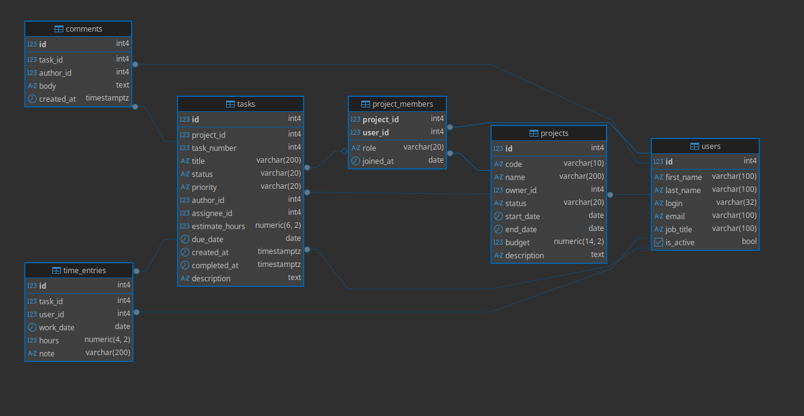

# ЛР 1. Проектирование и реализация реляционной базы данных

**Вариант 11 — система управления проектами.**

## Задание

По выданному варианту предметной области:

1. Выделить основные сущности, их атрибуты и связи.
2. Спроектировать реляционную модель данных в 3НФ.
3. Построить ER-диаграмму: таблицы и основные атрибуты, первичные и внешние ключи, связи.
4. Реализовать БД в PostgreSQL.
5. Заполнить БД тестовыми данными.
6. Продемонстрировать работу ограничений целостности.

Требования к БД: не менее 5 содержательных таблиц, не менее 2 `UNIQUE`, не менее 3 `CHECK`, хотя бы одно составное ограничение, `NOT NULL` для обязательных атрибутов. Типы данных, ключи и правила `ON DELETE` — по смыслу предметной области.

Тестовых данных должно хватать для проверки всех связей и ограничений, плюс минимум 5 некорректных `INSERT`/`UPDATE`, которые отклоняет PostgreSQL.

Отдельная часть: после сдачи основной модели преподаватель выдаёт изменение предметной области, его нужно внести через DDL (`ALTER TABLE` и т. п.) без пересоздания БД и с сохранением данных.

## Предметная область

IT-компания ведёт несколько проектов. В каждом проекте работает команда сотрудников с ролями (руководитель, аналитик, разработчик, тестировщик, дизайнер), один сотрудник может быть в нескольких командах. Работа делится на задачи с номером внутри проекта (CRM-3), статусом, приоритетом, автором и исполнителем — исполнителем может быть только участник команды этого проекта. К задачам пишут комментарии, сотрудники списывают на задачи отработанные часы.

## Файлы

| Файл | Содержание |
|------|------------|
| [schema.sql](schema.sql) | создание структуры БД: 6 таблиц, ключи, ограничения |
| [data.sql](data.sql) | тестовые данные |
| [constraints_test.sql](constraints_test.sql) | 19 операций, которые база отклоняет, и демонстрация `ON DELETE` |
| [er-diagram-crowsfoot.png](er-diagram-crowsfoot.png) | ER-диаграмма, нотация Crow's Foot |
| [er-diagram-idef1x.png](er-diagram-idef1x.png) | ER-диаграмма, нотация IDEF1X |
| `migration.sql` | изменение структуры по дополнительному требованию (выдаётся на защите) |

## ER-диаграмма



## Запуск

Из корня репозитория:

```bash
docker compose up -d
docker compose exec db psql -U student -d labs -f /labs/lab1/schema.sql
docker compose exec db psql -U student -d labs -f /labs/lab1/data.sql
docker compose exec db psql -U student -d labs -f /labs/lab1/constraints_test.sql
```

`schema.sql` и `data.sql` можно запускать повторно: первый пересоздаёт таблицы, второй очищает их и сбрасывает счётчики id.
